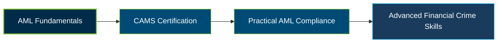

# ACAMS CAMS Certification Exam Guide

A dedicated study guide and financial crime reference repository for candidates preparing for the **ACAMS Certified Anti-Money Laundering Specialist (CAMS) Certification Exam**.

---

## Exam Overview

The ACAMS CAMS Certification validates knowledge of anti-money laundering (AML), financial crime risks, global compliance frameworks, and the programs and technologies used to detect and mitigate financial crime.

- **Exam Format**: Computer-based examination featuring multiple-choice and scenario-based questions.
- **Target Audience**: AML Analysts, Compliance Officers, KYC Analysts, Risk Managers, Internal Auditors, and Anti-Financial Crime Professionals.
- **Prerequisites**: Active ACAMS membership and 40 eligibility credits based on qualifying education, professional experience, certifications, and training.

---

## Core Exam Domains & Knowledge Areas

### 1. Understanding Risks and Methods of Financial Crime

- Money laundering methods, predicate offenses, and terrorist financing risks.
- Financial crime typologies, suspicious transaction indicators, and emerging threats.
- Risks across banking, non-bank financial institutions, and other business sectors.

### 2. Global AFC Frameworks, Governance and Regulations

- International AML and counter-terrorist financing standards and regulatory frameworks.
- Roles of financial intelligence units, regulators, and international organizations.
- Sanctions frameworks, regulatory obligations, and cross-border compliance considerations.

### 3. Building an AFC Compliance Program

- Risk-based AML compliance programs, institutional risk assessments, and internal controls.
- Customer due diligence (CDD), enhanced due diligence (EDD), and suspicious activity reporting.
- Governance, employee training, independent testing, monitoring, and program effectiveness.

### 4. Tools and Technologies to Fight Financial Crime

- Transaction monitoring, screening, and automated financial crime detection.
- Data analysis, technology-enabled controls, and investigation support tools.
- Evaluating technology risks and improving the effectiveness of AML controls.

---

## Certification Path

The following diagram illustrates a **suggested learning progression**, not an official ACAMS prerequisite or certification pathway.

---

## Recommended Practice & Study Resources

Combine official ACAMS learning materials with independent practice and practical AML compliance study.

- **CertsGate**: Explore available [CAMS certification preparation resources](https://certsgate.com/exams/acams/cams), including supplementary study materials and practice tests to reinforce AML concepts and identify knowledge gaps.
- **Practical AML Study**: Apply the [FATF Recommendations](https://www.fatf-gafi.org/en/publications/Fatfrecommendations/Fatf-recommendations.html) to case studies involving customer due diligence, risk assessment, sanctions, suspicious activity, and financial crime controls.
